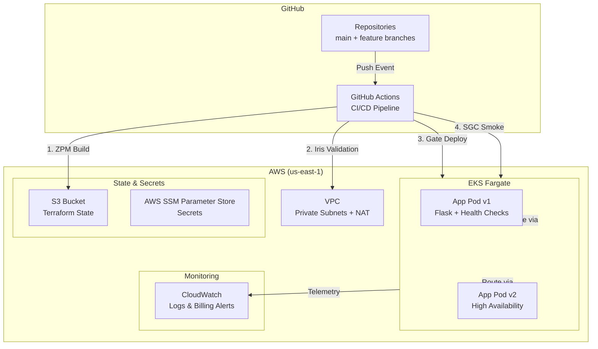

# Gateway Ops: Cloud-Native Test Infrastructure Pipeline

> "Through the gate lies a world of infinite possibilities."

One push provisions AWS infrastructure and deploys to EKS Fargate. Safety gates (Iris), routing intelligence (DHD), and automated validation (SGC) ensure nothing travels through unchecked.

This project bridges Terraform + Kubernetes automation, designed to demonstrate cloud-native test infrastructure architecture for senior QA/Test Infrastructure roles. Part of the Nexus/Orion portfolio series inspired by science fiction and fantasy universes.

## Franchise Lineage

| Project | Universe | Purpose |
|---------|----------|---------|
| **OrionAI** / `orion-validate` | *Chuck* | AI evaluation framework |
| **NexusQA** | Multi-franchise | Test automation core (LOTR, Narnia, HP, Stargate, Star Trek, etc.) |
| **Nexus Trials** | *Mario* + *Pokémon* | Integration test harness |
| **SpareOom** | *Chronicles of Narnia* | Personal utilities |
| **Gateway Ops** | *Stargate* | **Cloud infrastructure pipeline** ← *this project* |

## Architecture Overview



## What This Demonstrates

| Skill Area | How This Project Shows It |
|------------|---------------------------|
| **Infrastructure-as-Code** | Terraform with modular VPC, S3 state backend, DynamoDB locking |
| **Kubernetes Orchestration** | EKS Fargate deployments with health probes and resource limits |
| **CI/CD Pipeline Design** | GitHub Actions with staged validation gates |
| **Secret Management** | AWS SSM Parameter Store (mirrors Azure KeyVault expertise) |
| **Observability** | CloudWatch logging + cost monitoring alerts |
| **Cost Awareness** | Automated billing alerts + destroy scripts for idle resources |
| **Build Provenance** | Package name/build number/commit hash baked into container images |
| **Correlation-ID Propagation** | User-Agent instrumentation across service calls |

## Prerequisites

- Docker Desktop (with WSL 2 backend)
- Kind (Kubernetes IN Docker) ≥ 0.20.0
- Terraform ≥ 1.5.0
- kubectl installed locally
- Python 3.11+ (for local development testing)
- GitHub account with Actions enabled

## Quick Start (Local Development Mode)

### 1. Create Local Kubernetes Cluster

```bash
# Install Kind
brew install kind  # macOS/Linux
winget install kind  # Windows

# Create cluster (enables Kustomize in latest image)
kind create cluster --name gateway-ops
```

### 2. Deploy Application (via Kustomize)

```bash
# Build container image with provenance
docker build --build-arg PACKAGE_NAME=gateway-ops \
  --build-arg BUILD_NUMBER=local \
  --build-arg COMMIT_SHA=$(git rev-parse HEAD) \
  -t gateway-ops-app:v1.0.0 .

# Load into Kind
kind load docker-image gateway-ops-app:v1.0.0 --name gateway-ops

# Deploy via Kustomize (handles dependency ordering)
kubectl apply -k k8s/

# Verify pods
kubectl get pods -n sgc
```

### 3. Port Forward and Test

```bash
kubectl port-forward svc/gate-service 8080:80 -n sgc

# In a second terminal:
curl http://localhost:8080/
curl http://localhost:8080/health
curl http://localhost:8080/version
curl http://localhost:8080/dial-out
```

Expected response on `/version`

```bash
{
  "package": "gateway-ops",
  "build_number": "local",
  "commit_sha": "<full-sha>",
  "user_agent": "gateway-ops/local (<sha>)",
  "pod": "<pod-name>"
}
```

### 4. Prove Fault Tolerance (Optional but Recommended)

```bash
# Kill a pod and watch Kubernetes self-heal
kubectl delete pod -l app=gateway-ops-app -n sgc

# Immediately re-run smoke test - traffic fails over to surviving pod
curl http://localhost:8080/health
```

## Pipeline Stages: Stargate Naming Convention

This project uses Stargate universe elements to name pipeline components. This makes the workflow easier to navigate and adds intentional flavor.

| Stage | Franchise Reference | File/Job Name | Purpose |
|-------|---------------------|---------------|---------|
| **ZPM Build** | Atlantis (Zero Point Module) | `.github/workflows/zpm-build.yml` | Container image build + push to ECR |
| **Asgard Scan** | SG-1 (Advanced Ally) | `.github/workflows/asgard-scan.yml` | Security vulnerability scanning |
| **Iris Validation** | SG-1 Iris Shield | `scripts/iris-validation.sh` | Blocks unauthorized infrastructure changes |
| **Lantean Shield** | Atlantis (Ancient Energy Barrier) | `scripts/lantean-shield` | Secondary validation (strict, subatomic level) |
| **Prometheus Launch** | SG-1 (X-303 Flagship) | `.github/workflows/prometheus-launch.yml` | Terraform apply + k8s deployment |
| **DHD Config** | SG-1 Dial Home Device | `k8s/dhd-config.yaml` | Routing/configuration management |
| **SGC Smoke Tests** | SG-1 Command | `scripts/sgc-smoke.sh` | Post-deployment health verification |
| **Destiny Monitor** | SGU Destiny Sensors | `scripts/destiny-monitor.tf` | CloudWatch billing alerts |
| **Wormhole Dump** | Atlantis Wormhole Dump | `scripts/dump-wormhole.sh` | Cleanup/teardown script |

### Ships vs Hardware Naming Rule

- **Ships/Workflows** (`*.yml`): Named after spacecraft (Prometheus, Daedalus, X-302) - these move things through the pipeline
- **Hardware/Manifests** (`*.yaml`): Named after gate components (gate-deployment, dhd-config) - these define the destination

This distinction prevents collisions and makes the codebase self-documenting.

## Testing Strategy

Pipeline Flow:
  ├── ZPM Build (container image + security scan)
  ├── Asgard Scan (dependency vulnerability check)
  ├── Iris Validation (Terraform plan policy check)
  ├── Prometheus Launch (rolling update to Fargate)
  └── SGC Smoke (health endpoint + correlation ID validation)

Smoke test include:
- Health endpoint responsiveness
- Correlation ID propagation across services
- User-Agent instrumentation matching (gateway-ops/<build-number> <commit-sha>)
- Pod readiness probe verification
- Resource limit compliance
- "Comtrya!" greeting endpoint verification

## Related Projects
- **orion-validate** - Statistical QA framework for non-deterministic AI systems (published on PyPI)
- **NexusQA** - Test automation core framework with multi-franchise component naming
- **Nexus Trials** - Integration test harness based on Mario/Pokemon mechanics
- **SpareOom** - Personal utilities inspired by Chronicles of Narnia

## License

MIT - Feel free to fork and modify. Attribution appreciated but not required

Built by **Samuel Patchet** - Software QA Automation Architect | 10+ years designing test infrastructure and developer platforms.